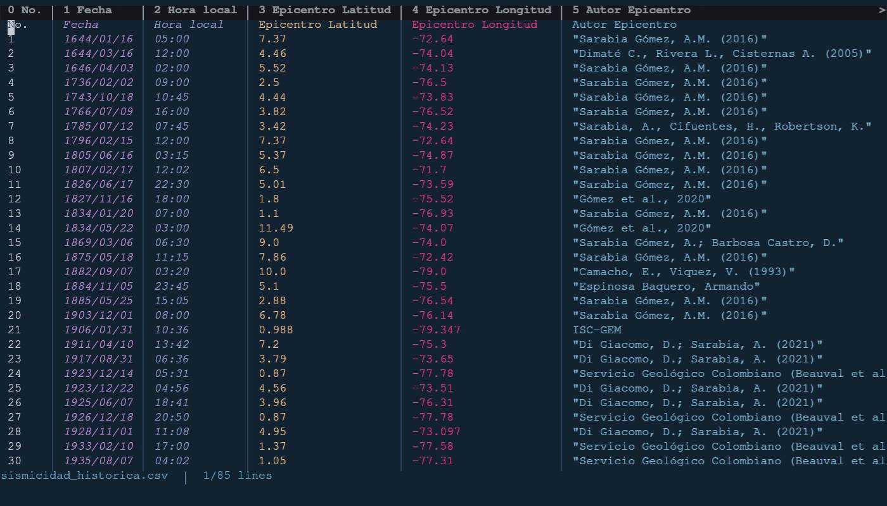

# csvkit.nvim

View, sort, filter and fill in CSV files without leaving Neovim. No dependencies.



> [!IMPORTANT]
> csvkit.nvim is built for **small files (under about 100 MB)**: looking at data quickly, filtering it, and filling in or fixing values. It is not a big-data tool; for bigger files use Excel or pandas. It may still work on much larger files (it was measured up to 824 MB), but that is not a goal. See [Performance and limits](docs/performance.md).

## Features

- **Aligned columns.** Open a CSV and its columns line up, with the header row pinned to the top of the window. You still edit the file itself: the alignment is only drawn on screen.
- **Sort** by any column, as numbers, text or dates.
- **Filter** like a spreadsheet: tick the values to keep from a column's list, or keep the rows matching a condition such as `price > 100`. Filters only hide rows; they never delete them.
- **Add and delete** rows and columns, a new column wherever you want it. A new column can hold a fixed text, the result of a [formula](docs/formulas.md), or values you type row by row.
- **Stats** of a column (`:Csvkit stats`): max, newest date, most common value, the largest and smallest values, every value with its count. Pick one to copy it.
- **Formulas** such as `price * qty`, `IF(...)`, `ROUND(...)`, date arithmetic, and `PREV(...)` to use the previous row (for growth and differences; an empty previous value counts as 0).
- **Table view** (`:Csvkit view`): a separate table where you can try sorts, filters and edits safely. Nothing reaches the file until you run `:Csvkit apply`.
- **Browser preview** (`:Csvkit preview`): the file as a table in your browser, with sorting and filtering, refreshed as you edit.
- **Restore** the file exactly as it was when you opened it, even after saving.
- **Every command is one undo step**, and rows a command doesn't touch keep their exact text.
- Loads nothing until you open a CSV file or run a command, so it doesn't slow down Neovim's startup.

## Requirements

Neovim **0.10 or newer**. Nothing else. (The browser preview needs a browser; opening it uses `vim.ui.open`.)

## Install

<details open>
<summary><b>lazy.nvim</b></summary>

```lua
{ "Andres-pixel35/csvkit.nvim", ft = { "csv" }, opts = {} }
```

If you add more extensions (`opts = { extensions = { "csv", "tsv" } }`), `ft` (or `event = "BufReadPre *.tsv"`) must list the same ones.

</details>

<details>
<summary><b>packer.nvim</b></summary>

```lua
use { "Andres-pixel35/csvkit.nvim", ft = { "csv" }, config = function() require("csvkit").setup() end }
```

</details>

<details>
<summary><b>vim-plug</b></summary>

```vim
Plug 'Andres-pixel35/csvkit.nvim'
```

`setup()` is optional; call `lua require("csvkit").setup({ ... })` only to change options.

</details>

<details>
<summary><b>mini.deps</b></summary>

```lua
MiniDeps.add("Andres-pixel35/csvkit.nvim")
require("csvkit").setup()
```

</details>

<details>
<summary><b>vim.pack (Neovim 0.12)</b></summary>

```lua
vim.pack.add({ "https://github.com/Andres-pixel35/csvkit.nvim" })
require("csvkit").setup()
```

</details>

<details>
<summary><b>Manual</b></summary>

```sh
git clone https://github.com/Andres-pixel35/csvkit.nvim \
  ~/.local/share/nvim/site/pack/plugins/start/csvkit.nvim
```

</details>

`setup()` is optional. Without it the defaults apply and `.csv` files are picked up automatically.

## Quick start

Open a CSV file: its columns are aligned right away. Everything else is one command, `:Csvkit`, followed by a subcommand. Press `<Tab>` after `:Csvkit ` to complete subcommands, options and column names.

```vim
:Csvkit sort price desc                    " sort by the price column, largest first
:Csvkit filter price > 10                  " show only rows where this is TRUE
:Csvkit addcol total formula price * qty   " new column computed from others
:Csvkit stats price                        " max, sum, most common... <CR> copies one
:Csvkit view                               " open the table view
:Csvkit restore                            " undo everything: back to the file as opened
```

**Columns** are named by their header (`price`) or by their number, **counting from 0**: `0` is the first column. You don't need to count: the pinned header shows each column's number before its name (`0 id │ 1 price │ 2 qty`). Negative numbers count from the end (`-1` is the last column). Leave the column out and the one under the cursor is used.

Commands change the buffer like any edit: `u` undoes one, `:w` saves. See [all commands](docs/commands.md).

## Suggested keymaps

csvkit defines **no keymaps**; here is an example you can copy into your `init.lua`.

<details>
<summary><b>Example</b></summary>

```lua
vim.api.nvim_create_autocmd("FileType", {
  pattern = { "csv", "csvkit_view" }, -- CSV files and the :Csvkit view table
  callback = function(ev)
    local function map(lhs, cmd, desc)
      vim.keymap.set("n", lhs, "<cmd>Csvkit " .. cmd .. "<cr>", { buffer = ev.buf, desc = desc })
    end
    map("<leader>ks", "sort asc", "Sort ascending")
    map("<leader>kS", "sort desc", "Sort descending")
    map("<leader>kf", "filter", "Filter column")
    map("<leader>kF", "filter clear", "Clear filters")
    map("<leader>kv", "view", "Table view")
  end,
})
```

Each key runs a command: `<cmd>Csvkit sort asc<cr>` types `:Csvkit sort asc` and presses Enter (`<cr>`), without leaving normal mode. The `FileType` rule makes the keys exist only in CSV buffers and in the table view. Any command can be mapped, arguments included (`<cmd>Csvkit sort price desc<cr>`): see [all commands](docs/commands.md#all-commands).

</details>

<details>
<summary><b>The same with lazy.nvim</b></summary>

Put the keys in the plugin spec instead:

```lua
local ft = { "csv", "csvkit_view" } -- CSV files and the :Csvkit view table

return {
  "Andres-pixel35/csvkit.nvim",
  ft = { "csv" },
  opts = {},
  keys = {
    { "<leader>ks", "<cmd>Csvkit sort asc<cr>", ft = ft, desc = "Sort ascending" },
    { "<leader>kS", "<cmd>Csvkit sort desc<cr>", ft = ft, desc = "Sort descending" },
    { "<leader>kf", "<cmd>Csvkit filter<cr>", ft = ft, desc = "Filter column" },
    { "<leader>kF", "<cmd>Csvkit filter clear<cr>", ft = ft, desc = "Clear filters" },
    { "<leader>kv", "<cmd>Csvkit view<cr>", ft = ft, desc = "Table view" },
  },
}
```

Here `ft` limits the keys to CSV buffers and the table view. `opts = {}` uses the defaults. Every option and its default is in [Configuration](docs/configuration.md).

</details>

## Documentation

| Page | What is in it |
|---|---|
| [Commands](docs/commands.md) | Every `:Csvkit` command with examples, how to name columns, undo, keymaps |
| [Views](docs/views.md) | The aligned columns, how filters hide rows, the table view, the browser preview |
| [Formulas](docs/formulas.md) | Writing formulas: columns, operators, functions, `PREV`, errors |
| [Configuration](docs/configuration.md) | Every option explained, per-file settings, how numbers and dates are recognised |
| [Performance and limits](docs/performance.md) | How fast it is on files of different sizes, known limits, memory use |

Inside Neovim, `:help csvkit` has the same reference.

## Known limits

- **Files under about 100 MB.** See [Performance and limits](docs/performance.md).
- **Rows with a line break inside a cell are not aligned** in the file's buffer: Neovim can't draw several lines of a file as one screen line, so such a row shows as raw text across its lines. Use `:Csvkit view`, which shows every row on one line. Every command still handles these rows correctly. [More](docs/views.md#aligned-overlay).

## How it works, in short

<details>
<summary>Show</summary>

- **Edits are safe.** Every command changes the buffer in a single edit, so one `u` undoes it. Rows a command doesn't touch keep their exact text, quoting included.
- **Your file is backed up.** When a file opens, a copy is kept on disk (under `stdpath("state")`, readable only by you) until you close the buffer, so `:Csvkit restore` can always bring the original back. `restore.backup = false` turns this off.
- **Values are recognised strictly.** A cell is a number, a date, TRUE/FALSE or text by clear rules: `0x1A`, `inf` or `$12` are text, not numbers. See [Value types](docs/configuration.md#value-types).
- **Nothing leaves your machine.** The browser preview is served only on `127.0.0.1`, behind a random secret in its address. No telemetry.

</details>

## Not related to the Python csvkit

This plugin is not related to [csvkit](https://github.com/wireservice/csvkit), the Python command-line tools for CSV files, and doesn't use them. They only share a name.

## License

[MIT](LICENSE)
